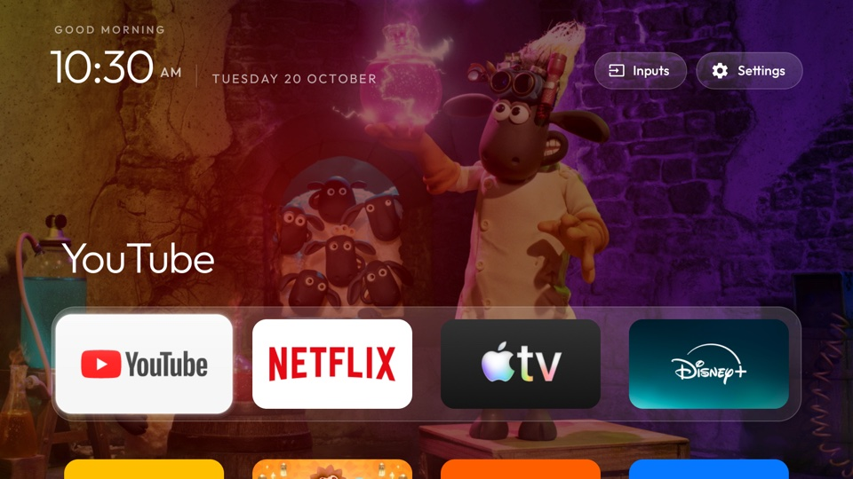

# Clean Your TV — with movie wallpapers

**A calm, movie-lit home screen for Android TV and Google TV.**

This is cocombee's fork of [CleanYourTV](https://github.com/Gathin23/cleanyourtv) by Gathin, not the
official project. It keeps everything CleanYourTV does — debloat any Android TV over Wi-Fi, no root, fully reversible, and swap the ad-filled home
screen for a light Apple TV-style launcher — and adds a home screen that changes with the films that are out now.



## What this fork adds

- **Movie wallpapers that update themselves.** Once a day the TV asks [TMDB](https://www.themoviedb.org) for
  the 10 most popular films of the last 75 days, downloads their backdrops, deletes the old ones and rotates
  through them. Pictures are dimmed and centred on their subject so the clock and tiles stay readable.
  Adult titles are never fetched, horror and thriller are left out by default, and you can limit it to
  animation and family films.
- **Rotating wallpapers of your own.** Put pictures in a theme's `wallpapers/` folder and choose how often they
  change, down to every 5 seconds. Each picture is decoded in the background and cross-faded.
- **Glass everywhere.** The dock band and the Inputs panel are frosted glass, like the top-bar buttons.
- **Rows feather out under the top bar** instead of being cut off when you scroll.
- **A calmer highlight.** The glass highlight glides onto a tile and stops, with no bounce, hugs the tile's
  corners exactly, and the focus zoom is a gentler 7 %.
- **Smooth colour.** The glow behind the dock blends straight from one app's colour to the next.
- **A tidier top bar.** Hide the Wi-Fi / Ethernet button (`show_network_pill`); the Inputs menu has outline
  HDMI icons and better-sized AV and Live TV icons.

| | |
|---|---|
|  |  |
| *The grid, feathering out under the top bar* | *Inputs: HDMI 1–3, AV and Live TV* |
|  | |
| *Your own wallpaper, with the network button hidden* | |

Still light: on a Xiaomi Mi TV with 1.8 GB of RAM the launcher uses about 65–80 MB, one wallpaper is in memory
at a time, the movie pictures take under 2 MB of storage, and nothing runs while you are inside an app.

## Setting it up

Debloating and installing work exactly as in CleanYourTV; its full guide is in
[docs/CLEANYOURTV-README.md](docs/CLEANYOURTV-README.md), and [PROMPT.md](PROMPT.md) lets a coding assistant do
it for you. In short:

```bash
python3 -m venv tools/venv && tools/venv/bin/pip install -r tools/requirements.txt
export TV_HOST=192.168.1.50                                   # your TV's IP address
tools/disable.sh examples/<your tv>/debloat.txt               # debloat
launcher/build-and-install.sh                                 # build the launcher and make it Home
tools/theme.sh themes/<your theme>                            # push your settings and wallpapers
```

## Turning on movie wallpapers

1. Get a free API key at [themoviedb.org → Settings → API](https://www.themoviedb.org/settings/api).
2. Make a theme folder with a `config.json` like this, and push it with `tools/theme.sh`:

```json
{
  "tmdb_api_key": "your key",
  "movie_region": "MY",
  "movie_genres": "16|10751",
  "wallpaper_seconds": 15,
  "show_network_pill": false
}
```

`movie_genres` `16|10751` means animation *or* family; leave it out for every genre. All keys are listed in
[themes/README.md](themes/README.md). Without a key, the launcher never goes online.

## Credits and licence

- Built on [CleanYourTV](https://github.com/Gathin23/cleanyourtv) © 2026 Gathin, MIT licence — see
  [LICENSE](LICENSE). Its debloat lists, tools and launcher are the foundation of this project.
- The Outfit typeface is under the SIL Open Font License (`launcher/FONT-LICENSE-OFL.txt`).
- The Inputs icon is from Google's Material Icons (Apache 2.0).
- This product uses the TMDB API but is not endorsed or certified by TMDB. Movie pictures are fetched on your
  own TV with your own key and are not part of this repository.
