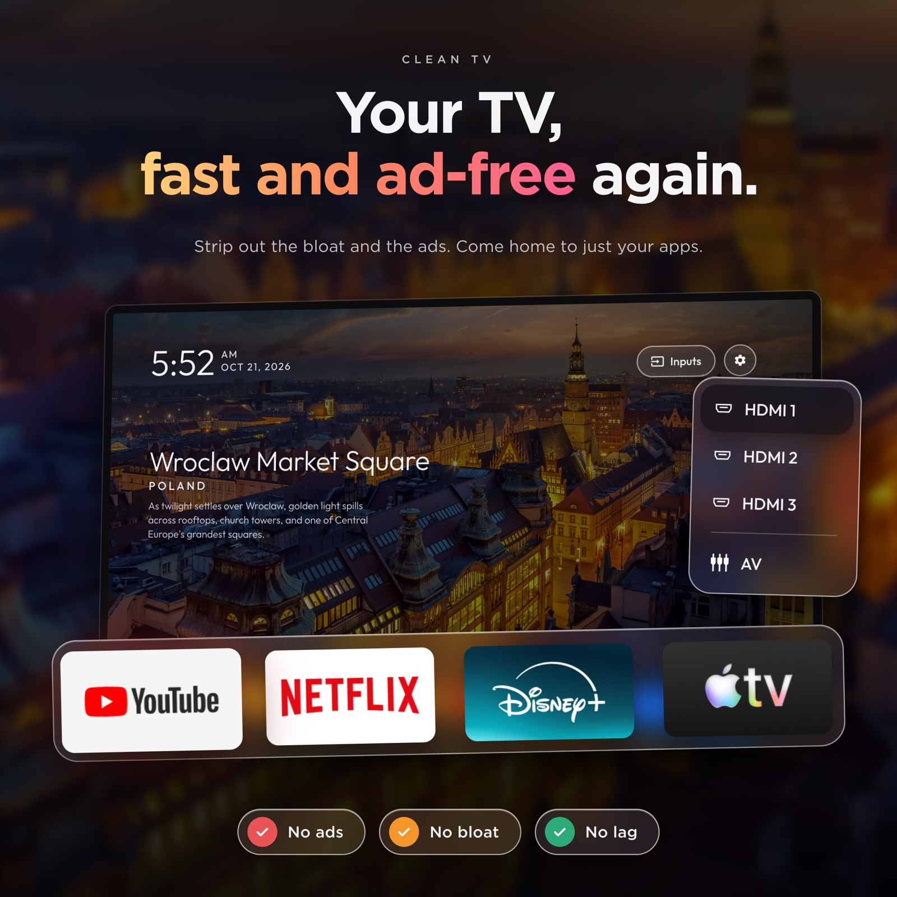
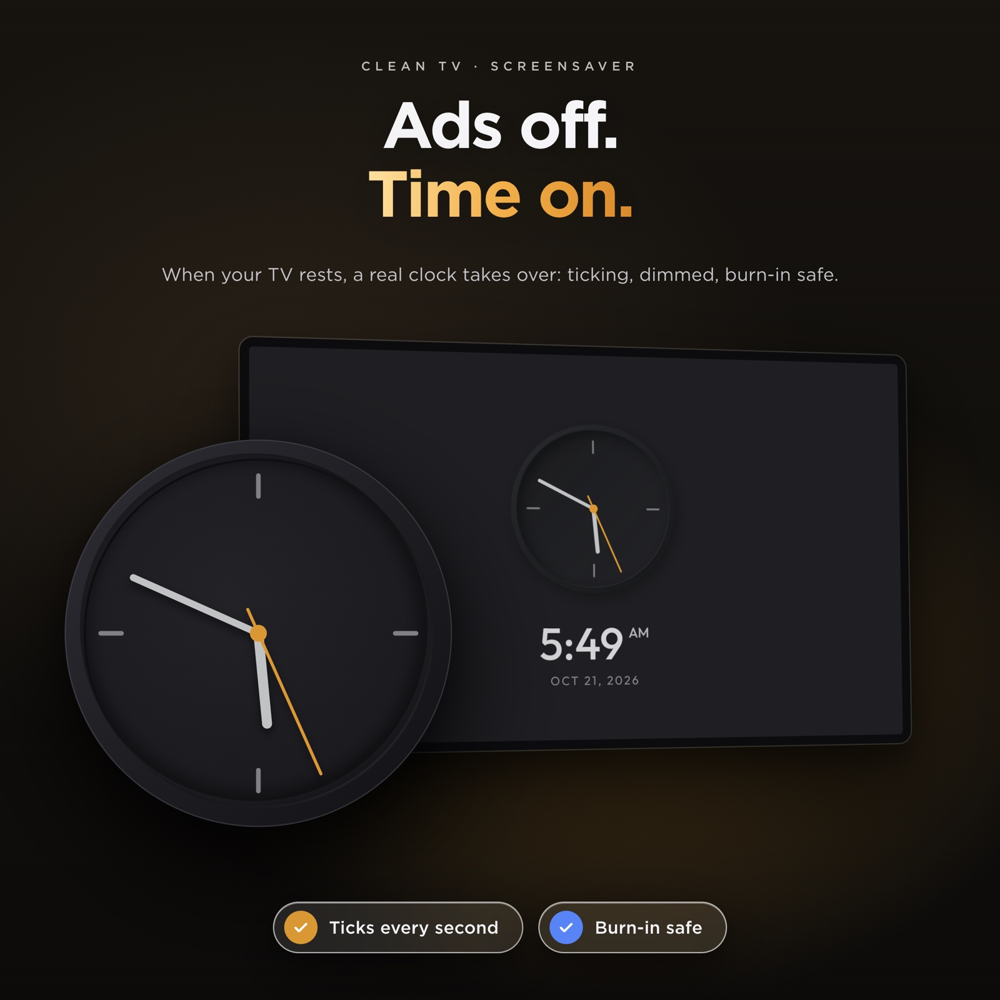
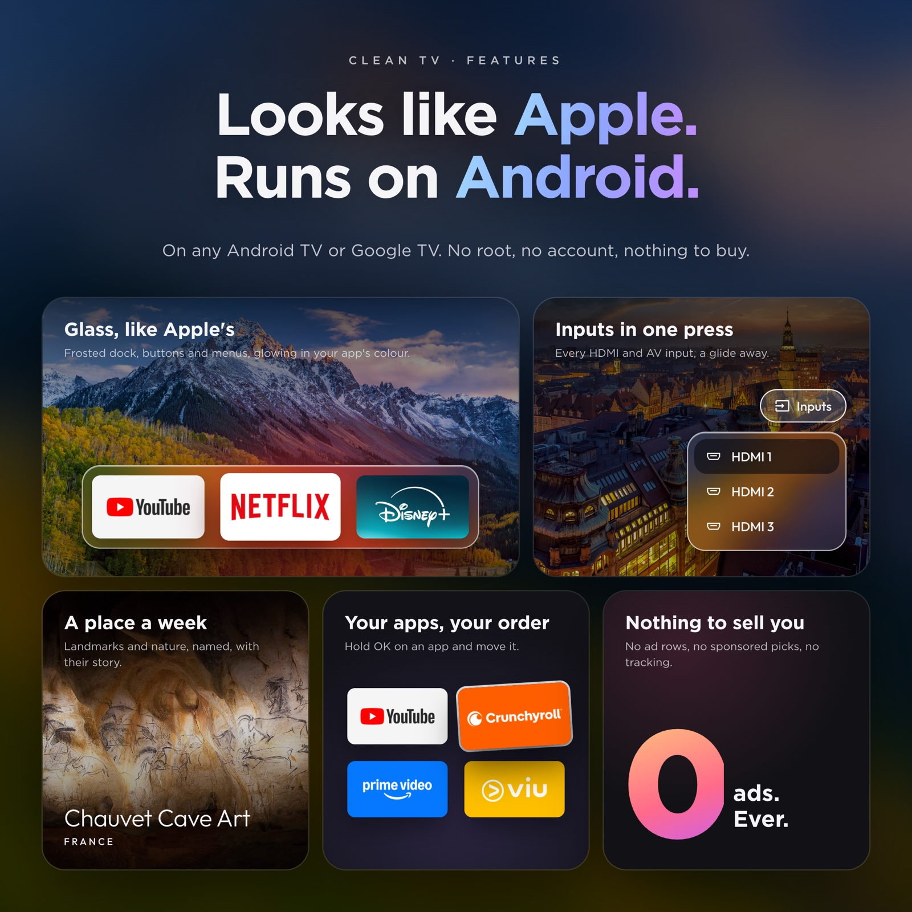
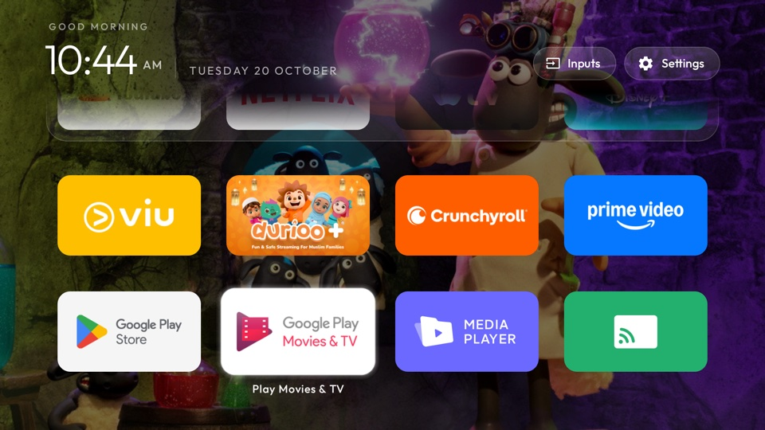
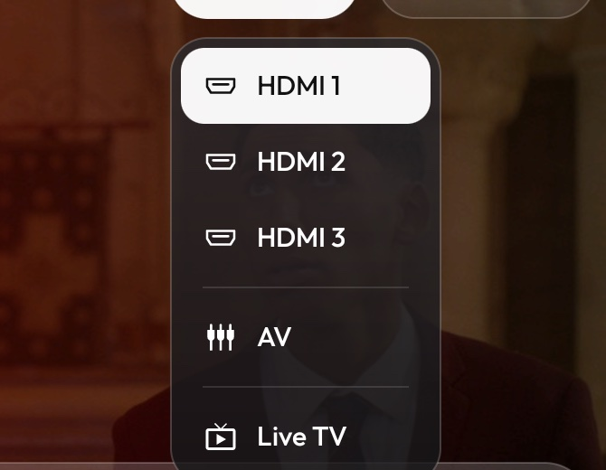
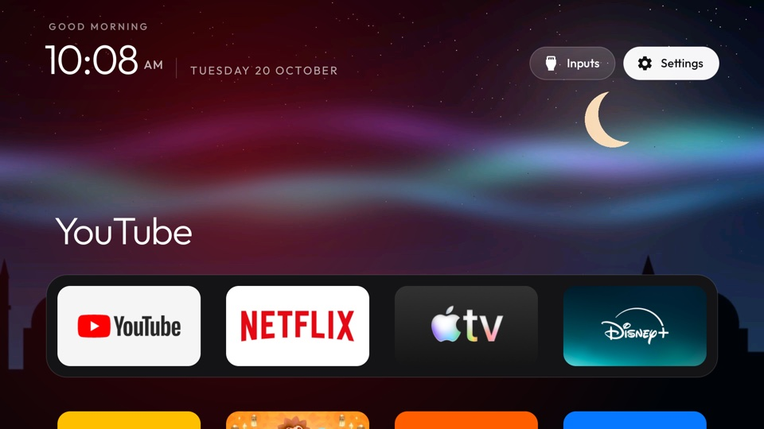

# Clean TV

**Make your Android TV or Google TV fast and ad-free again: strip out the bloat and ads, free up memory,
and come home to just your apps, with a new place to visit behind them every week.**

Based on [Clean Your TV](https://github.com/Gathin23/cleanyourtv) by Gathin. Not affiliated with it.
Clean TV keeps everything Clean Your TV does — debloat any Android TV over Wi-Fi, no root, fully reversible,
and swap the ad-filled home screen for a light Apple TV-style launcher — and adds a home screen that shows a
new set of places every week.

<p>
  
  
  
</p>

## What Clean TV adds

- **Places to visit that renew themselves.** Once a week the TV takes the pictures Bing has shown on its home
  page over the past days — landmarks, landscapes, wildlife — deletes last week's and rotates through them,
  dimmed so the clock and tiles stay readable. The shelf above the dock names each one, its country and a few
  lines about it. Pictures with people in them are skipped: by the words in their caption, and by Android's
  own face detector on the TV. No key, no account, nothing to set up.
- **Rotating wallpapers of your own** instead, with `"places": false`: put pictures in a theme's `wallpapers/`
  folder and choose how often they change, down to every 5 seconds. Each picture is decoded in the background
  and cross-faded.
- **Glass, like Apple's.** The dock's tray, the top-bar buttons and the menus show the picture behind them
  softened, with a shine along their edges. Android 10 has no live blur, so the picture is blurred once each
  time it changes and the glass draws its patch of it.
- **One selection that glides.** Between apps it is a pane of glass with the app's shadow under it; on the top
  bar and in the menus it is dark. It glides and changes shape from one to the next, never jumps.
- **Every app tints the room.** The glow behind Home, and the glass with it, blends to the colour of whichever
  app is selected.
- **Arrange your apps from the remote.** Hold OK on an app for a glass menu with **Move** and **App info**.
  Move picks the app up: it wiggles, the arrows carry it (into or out of the dock too) and the other apps
  slide aside; OK puts it down. The order is kept, and apps installed later join at the end.
- **An Inputs menu in glass.** The selection glides out of the Inputs button into the list of HDMI and AV
  inputs, and Up from the top of the list glides it back.
- **Comes back as you left it.** Back from an app, the app you left is still selected; pressing Home on Home
  goes to the first app. When Android has closed Home to free memory, it comes back whole in one frame,
  with no black screen and no half-built dock.
- **A clock screensaver.** A grey analog dial with a yellow-orange second hand that ticks, the time and
  date beneath, drifting a little each minute so nothing burns in.
- **Rows feather out under the top bar** instead of being cut off when you scroll, and the Wi-Fi / Ethernet
  button can be hidden (`show_network_pill`).

| | |
|---|---|
|  |  |
| *The grid, feathering out under the top bar* | *Inputs: HDMI 1–3, AV and Live TV* |
|  | |
| *Your own wallpaper, with the network button hidden* | |

Still light: on a Xiaomi Mi TV with 1.8 GB of RAM the launcher uses about 80–100 MB and stays there over hours
of use, one wallpaper is in memory at a time, the week's places take about 2 MB of storage, and nothing runs
while you are inside an app.

## Setting it up

**Using an AI coding agent** (Claude Code, Codex, Cursor, Copilot…)? Point it at this repository and ask it to
set up your TV. [AGENTS.md](AGENTS.md) tells any agent, even a small model, how to do it safely on any Android TV or Google
TV: it first checks that your TV can run it (Samsung, LG, Roku and Fire TV can't run the home screen), then
asks before each change, backs up first, never uninstalls, and checks each step with you as it goes.

Debloating and installing work exactly as in CleanYourTV; its full guide is in
[docs/CLEANYOURTV-README.md](docs/CLEANYOURTV-README.md), and [PROMPT.md](PROMPT.md) lets a coding assistant do
it for you. In short:

```bash
python3 -m venv tools/venv && tools/venv/bin/pip install -r tools/requirements.txt
export TV_HOST=192.168.1.50                                   # your TV's IP address
tools/disable.sh examples/<your tv>/debloat.txt               # debloat
launcher/build-and-install.sh                                 # build the launcher and make it Home
tools/theme.sh themes/<your theme>                            # push your settings and wallpapers
```

To stop the TV's storage filling with Play Store leftovers — which can corrupt
an app's cache badly enough to leave it launching to a blank screen —
[`tools/cache-clean.sh`](docs/cache-clean.md) finds the TVs on your network and
clears their caches, leaving sign-ins and app data untouched.

## Places, or pictures of your own

Places are on from the start. To change how often the picture changes, or to use your own pictures and keep
the launcher offline, make a theme folder with a `config.json` like this and push it with `tools/theme.sh`:

```json
{
  "places": false,
  "wallpaper_seconds": 15,
  "show_network_pill": false
}
```

All keys are listed in [themes/README.md](themes/README.md). With `"places": false`, the launcher never goes
online.

## Credits and licence

- Built on [CleanYourTV](https://github.com/Gathin23/cleanyourtv) © 2026 Gathin, MIT licence — see
  [LICENSE](LICENSE). Its debloat lists, tools and launcher are the foundation of this project.
- The Outfit typeface is under the SIL Open Font License (`launcher/FONT-LICENSE-OFL.txt`).
- The Inputs icon is from Google's Material Icons (Apache 2.0).
- Pictures of places and their captions are Bing's daily images (Microsoft). The launcher fetches them on your
  own TV; the promo pictures above show three of them.
- Gotham, used in the promo pictures only, is a Hoefler&Co. typeface and is not part of this repository.
